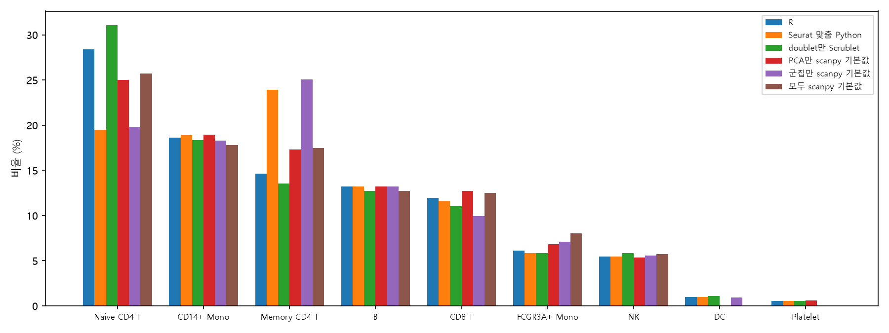

# 같은 단일세포 분석을 R과 Python으로 — 도구를 바꾸면 무엇이 달라지나

**질문:** R의 Seurat으로 한 [PBMC 3k 분석](https://github.com/Inseong-Park/pbmc-scrna)을 Python의 scanpy로 다시 하면, 결과가 어디서, 얼마나, 왜 달라지는가?



- **설정을 Seurat과 같게 맞추면** QC, 변이가 큰 유전자, PCA, 마커 유전자가 R과 사실상 같았다. 세포 2,638개가 하나까지 같았고, PC1–15의 세포 점수 상관은 0.996–1.000, 마커는 3,313개 중 3,308개가 같았다. 계산 코드가 달라서 생기는 차이는 거의 없었다.
- **차이가 생긴 곳은 세 종류였다.** doublet처럼 판단 방식 자체가 다른 도구, 군집처럼 같은 알고리즘이라도 프로그램이 다른 곳, 그리고 두 도구의 기본 설정이 다른 곳이다.
- **최종 결론에 주는 영향은 두 군데에 몰렸다.** 위 그림처럼 B, 단핵구, NK, CD8 T는 어떤 설정에서도 비율이 그대로였다. 흔들린 것은 경계가 애매한 Naive와 Memory CD4 T의 비율이었고, 둘을 합친 CD4 T는 42–45%로 그대로였다. 그리고 scanpy를 기본값 그대로 쓰면 전체의 1% 이하인 수지상세포와 혈소판을 놓쳤다.

---

## 데이터와 도구

- **데이터:** R 분석과 같은 10x Genomics PBMC 3k. 새로 받지 않고 R 프로젝트 폴더의 행렬을 그대로 읽었다.
- **도구:** Python 3.12, scanpy 1.12.6, anndata 0.13.4, Scrublet은 scanpy 내장, leidenalg, igraph, scikit-learn. 비교 대상은 R 4.4.3, Seurat 5.5.0, scDblFinder.
- **R 결과 불러오기:** 세포 하나하나를 비교하려고 R 분석의 결과인 변이가 큰 유전자, PC 점수, 군집, UMAP, SNN 그래프, 세포 유형을 `R/export_seurat.R`로 CSV로 내보냈다. R 결과를 읽기만 하고 새로 분석하지 않았다.

## 비교 방법

- **한 단계를 비교할 때는 그 단계의 방법만 R과 다르게 하고, 입력은 R과 똑같이 맞췄다.** 그 단계의 차이를 기록한 뒤 다음 단계로 넘어갈 때는 입력을 다시 R과 맞췄다. 앞 단계의 차이가 넘어오면, 다음 단계에서 결과가 달라졌을 때 원인을 하나로 짚을 수 없기 때문이다. 실험에서 조건 하나만 바꾸고 나머지는 똑같이 맞추는 것과 같다.
- **두 도구의 기본 설정이 다른 단계는 Python을 두 가지로 돌렸다.** scanpy를 아무 설정 없이 쓴 "기본값"과, 설정을 Seurat의 기본값과 똑같이 바꾼 "Seurat 맞춤"이다. R과 "Seurat 맞춤"의 차이는 코드 구현의 차이, R과 "기본값"의 차이는 여기에 기본 설정의 차이가 더해진 것이다.
- **마지막에 원본부터 다시 돌리며** Python 방식을 한 단계씩 넣어, 각 단계의 차이가 최종 세포 유형까지 바꾸는지 확인했다.

## 단계별 결과

| 단계 | R과 비교한 결과 |
|---|---|
| QC | 같은 기준이면 통과한 세포 2,638개가 하나까지 같다 |
| doublet | scDblFinder 133개, Scrublet 32개, 겹침 21개. 판단 방식이 달라 크게 다르다 |
| 정규화 → HVG → PCA | Seurat 맞춤은 HVG 1,999/2,000, PC 상관 0.996–1.000으로 같다. 기본값은 HVG 72%만 겹치고 PC 순서가 바뀐다 |
| 이웃 그래프 | Seurat 방식으로 만들면 R 그래프와 연결의 98.6%가 같다 |
| 군집 | R의 그래프를 그대로 써도 ARI 0.77. Naive CD4 T 713개 중 232개만 Memory 쪽으로 다르게 나뉜다 |
| UMAP | R과의 차이가 시작값만 바꿨을 때의 차이와 비슷하다. 대부분 무작위성이다 |
| 마커 | Seurat 맞춤은 3,313개 중 3,308개가 같다. 기본값은 상위 8개가 72개 중 9개만 같다 |
| 세포 유형 이름 | 같은 군집에 같은 근거로 붙이면 100% 같다 |
| 처음부터 다시 | 이름 일치율 86–92%. 기본값에서는 수지상세포와 혈소판이 사라진다 |

## 찾은 것

### 1. 같은 설정이면 계산 결과는 같다. 다른 것은 기본 설정이다

PCA에서 scanpy 기본값은 R과 크게 달랐지만, 정규화 총량, HVG 고르는 방법, 스케일링 상한 세 가지만 Seurat과 같게 바꾸면 PC1–15가 R과 같은 축이 되었다 ([그림 4d](results/figures/fig4d_pc_correlation.png)). 그래서 "scanpy와 Seurat은 결과가 다르다"보다 "기본 설정이 달라서 결과가 다르다"가 정확하다. scanpy 기본값에서는 스케일링 상한이 없어서, 전체의 0.6%인 혈소판 몇 개가 z-점수 15 근처의 극단값으로 PC2를 혼자 차지했다 ([그림 4b](results/figures/fig4b_pca_pc1_pc2.png)).

### 2. 설명서에 없는 기본 계산까지 맞춰야 같아진다

마커의 배수 차이를 처음에는 R과 상관 0.85로만 재현했다. 여러 식을 R 결과와 직접 비교해 보니 Seurat 5는 1을 평균이 아니라 합계에 더한 뒤 세포 수로 나눴고, 이 식으로 바꾸자 소수점 여섯째 자리까지 같아졌다. 또 R 결과표의 p-value 최댓값이 0.0099인 것을 보고, `FindAllMarkers`가 보정 전 p-value 0.01 미만만 돌려준다는 숨은 조건을 찾았다.

### 3. 군집은 경계가 애매한 곳에서만 도구에 따라 달라진다

Python의 Louvain은 R의 그래프를 그대로 넣어도 R과 ARI 0.77이었다. Seurat은 Louvain을 10번 돌려 가장 좋은 결과를 고르고 igraph는 1번 돌린다. 이 차이는 B세포처럼 빈 공간으로 떨어진 무리에는 영향이 없었고, 중간 세포로 이어진 Naive와 Memory CD4 T의 경계에서만 나타났다 ([그림 5e](results/figures/fig5e_cluster_match.png)). R 안에서 기준을 바꿨을 때 흔들린 곳과 같은 곳이다.

### 4. 작은 집단은 기본값에서 사라질 수 있다

scanpy 기본 그래프는 세포당 연결이 약 20개로 Seurat 방식의 71개보다 적어서, 혈소판 14개가 단핵구 군집에 흡수됐다. scanpy 기본 PCA는 수지상세포를 가르는 축이 PC 9개 안에 들어오지 않아 수지상세포 25개가 단핵구 군집에 섞였다. 그래서 scanpy를 처음부터 끝까지 기본값으로 쓰면 9개가 아니라 7개 세포 유형만 나왔다 ([그림 9b](results/figures/fig9b_all_default_vs_r.png)).

### 5. 마커의 순위 기준은 묻는 질문이 다르다

Seurat 결과를 배수 차이 순서로 정렬하면 그 군집에만 있는 유전자가 위로 오고, scanpy 기본값은 검정 점수 순서라서 많은 세포에서 꾸준히 높은 유전자가 위로 온다. 그래서 scanpy 기본값의 Naive CD4 T 상위 마커는 모두 리보솜 유전자였다. 어느 쪽도 틀리지 않았지만, 이름을 붙일 때는 알려진 마커를 함께 봐야 한다.

## 한계

- **데이터 하나, 공여자 1명:** 비교 결과가 다른 데이터에서도 같다고 말할 수 없다. 특히 세포 유형이 더 많거나 배치가 섞인 데이터에서는 군집 차이가 더 클 수 있다.
- **도구 버전:** Seurat 5.5.0과 scanpy 1.12.6의 기본값을 비교했다. 버전이 바뀌면 기본값도 바뀔 수 있다.
- **이름 빌려 오기:** 처음부터 다시 돌린 결과에는 R 세포 이름을 다수결로 빌려 붙였다. 새 군집마다 마커를 다시 찾아 이름을 붙인 것은 아니다.
- **Louvain 반복:** Python에서 Louvain을 Seurat처럼 10번 돌려 가장 좋은 결과를 고르게 하지는 않았다. 그렇게 하면 R과 더 가까워지는지는 확인하지 않았다.

## 재현 방법

이 저장소를 R 분석 저장소 `pbmc-scrna` 옆에 받아야 한다. 데이터와 R 결과를 그 폴더에서 읽는다. `work/`는 저장소에 포함하지 않았다.

```powershell
python -m venv .venv
.\.venv\Scripts\Activate.ps1
pip install -r requirements.txt
& "C:\Program Files\R\R-4.4.3\bin\Rscript.exe" R\export_seurat.R
```

| 순서 | 스크립트 | 하는 일 | R 대응 |
|---|---|---|---|
| 1 | `scripts/01_qc.py` | QC 지표, 세포 거르기 | `01_qc.R` |
| 2 | `scripts/01b_doublet.py` | Scrublet 판정, scDblFinder와 비교 | `01b_qc_extra.R` |
| 3 | `scripts/02_pca.py` | 정규화 → HVG → PCA, 두 설정 비교 | `02_pca.R` |
| 4 | `scripts/03_cluster.py` | 이웃 그래프 → 군집 → UMAP, 네 설정 비교 | `03_cluster.R` |
| 5 | `scripts/04_annotate.py` | 마커 두 설정 비교, 세포 유형 이름 | `04_annotate.R` |
| 6 | `scripts/05_robustness.py` | 원본부터 다시 돌리며 Python 방식을 한 단계씩 넣기 | `05_robustness.R` |

공통 경로와 데이터 읽기는 `scripts/common.py`에 있다. Windows에서 경로에 한글이 있으면 scanpy의 `read_10x_mtx`가 행렬을 읽지 못해서, 파일을 직접 열어 읽도록 바꿔 두었다. 스크립트마다 `▶ 직접 정할 값`으로 표시한 곳은 이 분석에서 정한 값이 저장되어 있다. 단계마다 무엇을 보고 어떻게 판단했는지는 [notes.md](notes.md)에 있다.
